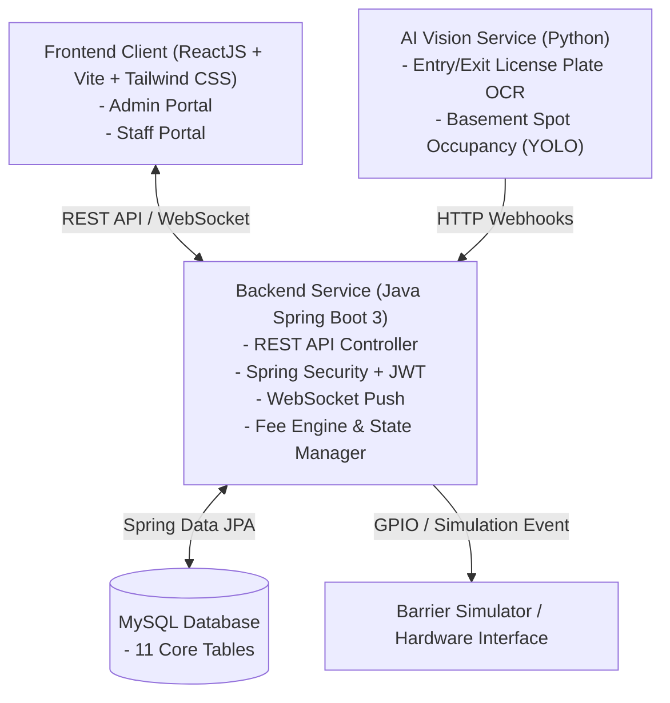

# SYSTEM ARCHITECTURE - SMARTPARK

## 1. Overview
SmartPark is an Intelligent Transportation System (ITS) for smart parking management applying AI for license plate recognition (LPR) and parking spot occupancy detection.

## 2. Architecture Diagram

## 3. Technology Stack
- **Frontend**: React 18, Vite, Tailwind CSS, Lucide Icons
- **Backend**: Java 17+, Spring Boot 3.3.4, Spring Security (JWT), Spring Data JPA, WebSocket
- **Database**: MySQL 8.0
- **AI Service**: Python (YOLOv8, OpenCV, EasyOCR / PaddleOCR)
- **Deployment**: Docker & Docker Compose
